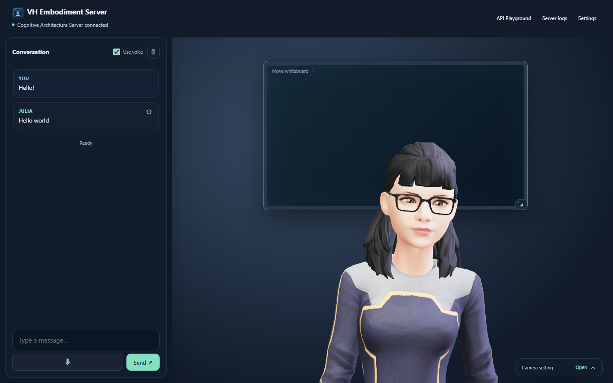

# AI-Powered Virtual Humans

**LLM-Powered Cognitive Architectures**

Build the Python agent behind a virtual human: from a first LLM call to conversation memory, structured behaviour and tools. The course connects psychological models of memory with the cognitive architectures used to give a virtual character continuity across interactions.

The course project connects a talking browser avatar to a Python cognitive architecture through a JSON API.

For the foundations of virtual humans and how to build an embodiment in Unity, see [Part 1: Embodiment in Unity](https://github.com/stevieTheTurtle/AI_powered_VH_2026-Part_1). It is recommended, but not required for this course.

## Repository folders

| Folder | Contents |
| --- | --- |
| [virtual_human_course](virtual_human_course/README.md) | Modules, slides, notebooks and course Python requirements |
| [virtual_human_project](virtual_human_project/README.md) | Avatar application, cognitive server and installers |

## Quick start

1. Choose **Code > Download ZIP** and extract the repository, or clone it. Keep both folders together.
2. Follow the [Installation guide](virtual_human_project/vh_embodiment_server/README.md). Run the installer for your computer; it prepares the application, Python and speech models.
3. Open the avatar and send a message. The default agent replies **"Hello world"**. No LLM account or API key is needed for this test.

   **Expected result:** VH Embodiment Server shows the avatar, a green connection indicator and the **"Hello world"** reply.

   

4. Install [VS Code](https://code.visualstudio.com/download), our course IDE, and its Microsoft [Python](https://marketplace.visualstudio.com/items?itemName=ms-python.python) and [Jupyter](https://marketplace.visualstudio.com/items?itemName=ms-toolsai.jupyter) extensions. VS Code is installed separately from the project.
5. In VS Code, open the extracted repository folder and the [first notebook](virtual_human_course/Module_0/Chapter_01/Code/00_first_call.ipynb). Under **Select Kernel**, choose `virtual_human_project/.venv-vh-course`, the environment created by setup.
6. Follow [Module 0: Introduction and Setup](virtual_human_course/Module_0/Chapter_01/Slides/Module_0_Chapter_01_Introduction_and_Setup.pdf) for the setup slides, provider keys and first LLM call.

To program the avatar's agent, follow the [Agent guide](virtual_human_project/vh_cognitive_architecture_server/README.md).

## Course materials

**Module 0: Introduction and Setup** introduces the virtual human project and guides you through installation, VS Code, provider keys and your first LLM call.

- [Slides (PDF)](virtual_human_course/Module_0/Chapter_01/Slides/Module_0_Chapter_01_Introduction_and_Setup.pdf) · [PowerPoint](virtual_human_course/Module_0/Chapter_01/Slides/Module_0_Chapter_01_Introduction_and_Setup.pptx)
- [First-call notebook](virtual_human_course/Module_0/Chapter_01/Code/00_first_call.ipynb): try the model providers using the shared Python environment.

**Module 1: Cognitive architectures, LLMs and LangChain** connects psychological memory models to context management, chains, structured avatar replies and a conversation-memory exercise.

1. [Psychological Foundations of Cognitive Architectures](virtual_human_course/Module_1/Chapter_01/Slides/Module_1_Chapter_01_Psychological_Foundations.pdf)
2. [LLMs, Working Memory and Prompting](virtual_human_course/Module_1/Chapter_02/Slides/Module_1_Chapter_02_LLMs_Working_Memory_and_Prompting.pdf)
3. [Introduction to LangChain](virtual_human_course/Module_1/Chapter_03/Slides/Module_1_Chapter_03_Introduction_to_LangChain.pdf)

The [course index](virtual_human_course/README.md) links the two Chapter 03 notebooks. Follow the slides, then open each notebook section when indicated.

**Module 2: From LLMs to virtual humans** builds agents as LangGraph graphs, gives them conversation memory with a checkpointer and connects that memory to the avatar.

1. [Agentic Frameworks and LangGraph](virtual_human_course/Module_2/Chapter_01/Slides/Module_2_Chapter_01_Agentic_Frameworks_and_LangGraph_Introduction.pdf)
2. [Memory and the Virtual Human](virtual_human_course/Module_2/Chapter_02/Slides/Module_2_Chapter_02_Memory_and_the_Virtual_Human.pdf)
3. [Tools and Coding Agents](virtual_human_course/Module_2/Chapter_03/Slides/Module_2_Chapter_03_Tools_and_Coding_Agents.pdf): extend the Chapter 02 avatar with weather tools and a whiteboard using Codex.
