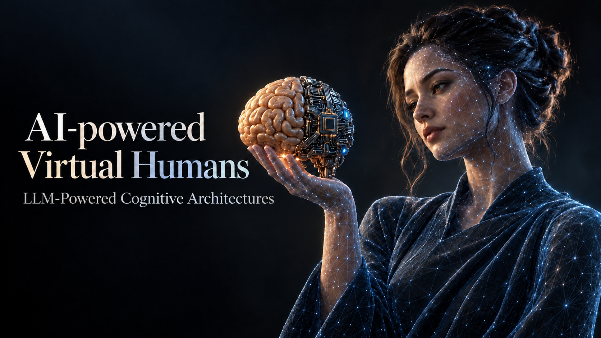

# AI-Powered Virtual Humans

**LLM-Powered Cognitive Architectures**

Build the Python agent behind a virtual human: from a first LLM call to conversation memory, structured behaviour and tools. The course connects psychological models of memory with the cognitive architectures used to give a virtual character continuity across interactions.

This course builds on [AI-Powered Virtual Humans, Part 1](https://github.com/stevieTheTurtle/AI_powered_VH_2026-Part_1), which explains how to develop the virtual human in Unity and its speech-to-text and text-to-speech pipeline. Part 1 is recommended but not required. Here, we start from that project and focus on the agent's cognitive architecture. For this course, please download [our integration version](unity_virtual_human/), even if you already have the Part 1 project, so that the Python code and dependencies match the course examples.

## Programme

| Module | Topics |
|---|---|
| **0 · Introduction and Setup** | Course project, model providers, Python environment and first LLM calls |
| **1 · Cognitive Architectures and Large Language Models** | Psychological foundations · LLMs, working memory and prompting · Introduction to LangChain |
| **2 · From Large Language Models to Virtual Humans** | LangGraph workflows · Stateful agents and conversation memory · Integration with the virtual human |
| **Webinar · The Virtual Meteorologist** | Extend the virtual human with tools and live weather data |

Use **Python 3.12** and **VS Code** with the Python and Jupyter extensions for the notebooks and the voice server. Use one shared course environment. Follow the Module 0 setup instructions when they are added. Use your own provider API key for the hosted model examples.
