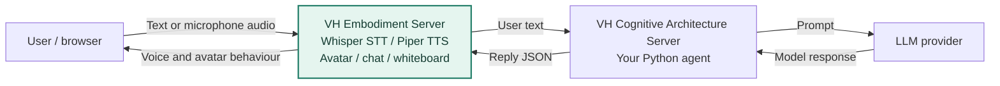

# Virtual Human Project

A talking browser avatar connected to an editable Python agent.

| Component | What it does | Guide |
| --- | --- | --- |
| VH Embodiment Server | Chat, microphone, local speech recognition and generation, avatar and whiteboard | [Install and launch](vh_embodiment_server/README.md) |
| VH Cognitive Architecture Server | Receives text, runs your agent and returns an avatar reply | [Edit and run an agent](vh_cognitive_architecture_server/README.md) |

Start with the installation guide. Setup creates `installation/` and one shared Python environment, `.venv-vh-course/`, inside this folder.

The public download uses a **mock agent** that replies **"Hello world"** to every message. This lets you check the installation without an LLM or key. To change the reply and build your agent, follow the [Cognitive Architecture Server guide](vh_cognitive_architecture_server/README.md).

## How a conversation works

The **VH Embodiment Server** handles both sides of the interaction: it turns user input into text for the agent, then turns the agent's reply into speech, avatar behaviour and whiteboard updates.

1. The browser sends typed text to `POST /api/chat` or microphone audio to `POST /api/voice-chat` on the embodiment server. Whisper converts audio to text locally.
2. The embodiment sends `{"text":"..."}` to `POST /agent` on the cognitive server. That server calls the selected `response()` function. The mock agent skips the LLM provider.
3. The cognitive server returns an `AgentReply`. The embodiment generates speech locally with Piper and sends the reply to the browser for lip-sync, emotion, expression, gesture and whiteboard updates.

The standalone `POST /api/speak` endpoint applies a reply directly. Use the API Playground to try it without a cognitive server.

The default addresses are `http://127.0.0.1:8899` for the embodiment and `http://127.0.0.1:8000` for the cognitive server. Speech runs locally; an online LLM receives the text your agent sends to it.
