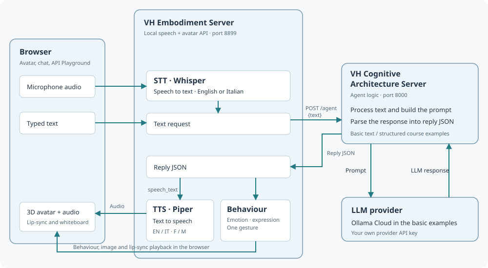

# Virtual Human Project

Two separate servers connect the course agent to a talking browser avatar:

| Folder | Role | Guide |
| --- | --- | --- |
| `vh_embodiment_server/` | Avatar, whiteboard, local STT/TTS and browser API | [Install, use and build](vh_embodiment_server/README.md) |
| `vh_cognitive_architecture_server/` | Agent logic and LLM provider calls; currently the basic SDK and LangChain examples | [Start the cognitive server](vh_cognitive_architecture_server/README.md) |

The embodiment EXE opens the avatar. In Settings > Cognitive Architecture Server, launch the cognitive server automatically or start it separately in the course Python environment. Follow the linked guides for installation and startup. For the course, install the embodiment into `virtual_human_project/installation/`.

`vh_cognitive_architecture_server/llm_provider_api_key.yaml` holds your local provider keys. It is excluded from Git; use the example file in that folder for a fresh checkout.

## Infrastructure

1. The browser sends microphone audio or typed text to the **VH Embodiment Server**. Whisper STT converts audio to text; typed text skips STT.
2. The embodiment sends `{text}` to the **VH Cognitive Architecture Server**.
3. The cognitive server builds a prompt, calls the **LLM provider**, and returns the result as reply JSON.
4. The embodiment generates speech through Piper TTS. The browser plays it with lip-sync and applies emotion, expression and one gesture. The same reply includes `whiteboard`: the agent program currently sets it to `null`; it is not generated by the LLM. Board updates can be tested in the Playground.

STT and TTS run locally. The LLM provider receives the text sent by the cognitive server.
