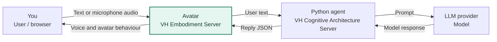

# Project overview

The project has two connected parts:

| Component | Role |
| --- | --- |
| VH Embodiment Server | Displays the avatar and handles chat, speech and the whiteboard |
| VH Cognitive Architecture Server | Runs your Python agent and returns its answer |

**Start with the [Installation guide](vh_embodiment_server/README.md).** The default agent replies "Hello world" so you can test the connection without an LLM. Then follow the [Agent guide](vh_cognitive_architecture_server/README.md) to program its behaviour.

## How a conversation works

The **VH Embodiment Server** handles both sides of the interaction: it turns user input into text for the agent, then turns the agent's reply into speech, avatar behaviour and whiteboard updates.

1. The browser sends typed text to `POST /api/chat` or microphone audio to `POST /api/voice-chat` on the embodiment server. Whisper converts audio to text locally.
2. The embodiment sends `{"text":"..."}` to `POST /agent` on the cognitive server. That server calls the selected `response()` function. The mock agent skips the LLM provider.
3. The cognitive server returns an `AgentReply`. The embodiment generates speech locally with Piper and sends the reply to the browser for lip-sync, emotion, expression, gesture and whiteboard updates.

The standalone `POST /api/speak` endpoint applies a reply directly. Use the API Playground to try it without a cognitive server.

The default addresses are `http://127.0.0.1:8899` for the embodiment and `http://127.0.0.1:8000` for the cognitive server. Speech runs locally; an online LLM receives the text your agent sends to it.
